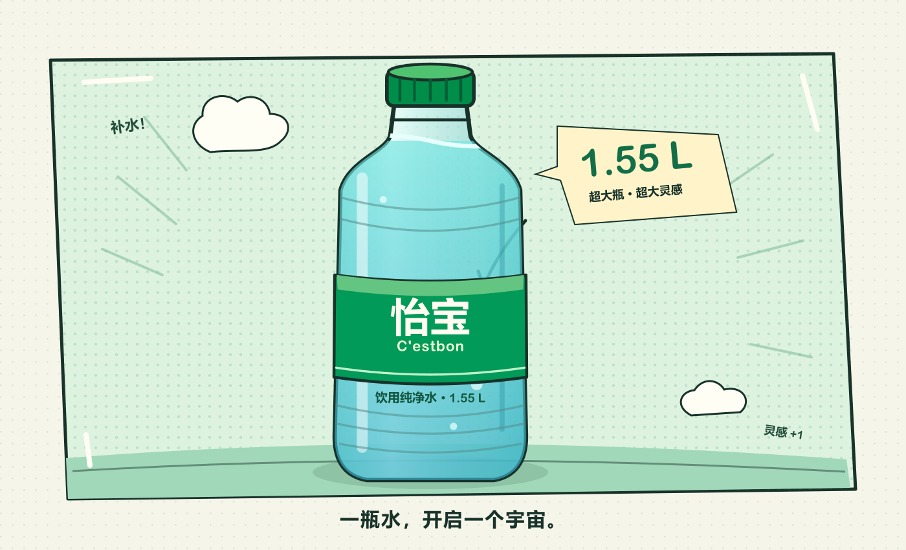

# Codex Startup Animation

一个非官方的卡通启动动画：超大号 1.55L 怡宝风格水瓶登场，名叫 **codex** 的火柴人拧盖喝水，肚子变成水气球，最后以云朵、星星和彩纸的漫画爆炸进入对话。全程无血腥，角色保持完整。



项目保留可编辑的 SVG 动画源码，并提供预渲染的 **60fps 本地 WebM 视频**。正常播放为 7.6 秒剧情、0.5 秒漫画爆炸和 0.5 秒渐隐；如果应用尚未准备好，动画会停在喝饱的姿势等待。

本仓库公开动画、演示页面、生成脚本和测试。它不包含 Codex 客户端、EXE、ASAR、官方应用代码或客户端补丁工具；下载本项目不会自动给 Codex 桌面应用安装动画。演示里的对话界面是项目自带的模拟界面。

## 运行演示

克隆或下载仓库后，直接用浏览器打开 **`demo/index.html`**。视频资源已包含，观看演示无需安装制作依赖。

如果浏览器限制本地文件播放，使用 Node.js 20.9 或更高版本启动本地服务：

```sh
npm start
```

然后打开 `http://localhost:8080`。点击动画或按 `Esc` 可跳过；系统开启“减少动态效果”时显示静态首帧并缩短退场。

## 修改与重新制作

主要文件：

| 文件 | 用途 |
| --- | --- |
| `src/cartoon-source.js` | SVG 绘制、角色动作和漫画爆炸的原始时间线 |
| `src/video-startup.js` | 本地视频播放、首帧等待、暂停、跳过和退场清理 |
| `src/readiness.js` | 观察对话编辑器是否可见、可编辑并完成布局 |
| `assets/` | 已生成的视频与首帧图片 |
| `scripts/` | 演示生成、帧渲染、视频编码与本地服务 |
| `tests/` | 使用 Node 内置模块运行的生命周期检查 |

修改播放逻辑后，重新生成演示：

```sh
npm run build:demo
```

修改 SVG 绘制或剧情后，重新渲染并编码视频。制作过程需要 Node.js、Python，以及下面的制作依赖：

```sh
npm install
python -m pip install -r requirements.txt
npm run render
python scripts/encode-video.py
npm run build:demo
```

`sharp` 负责把 SVG 状态渲染为图片；OpenCV 和 NumPy 用于生成和检查 VP8/WebM 视频。它们只用于制作，不参与浏览器播放。中间帧写入 `build/frames/`，最终资源写入 `assets/`。编码器需要支持 VP8；脚本在编码器不可用时会报错。

## 对接自己的界面

`src/video-startup.js` 创建全屏覆盖层，并提供 `window.__codexStartupVisual`：

| 接口 | 行为 |
| --- | --- |
| `finish()` | 请求结束；正常模式等待剧情结束，再播放爆炸和渐隐 |
| `cancel()` | 立即移除覆盖层并释放资源 |
| `done` | 覆盖层移除后完成的 Promise，结果包含结束原因 |
| `notBefore` | 最早结束时刻，包含后台暂停时间 |
| `setStatus(text)` | 更新简短的加载提示 |

可以在自己的应用准备好时调用 `finish()`。请让视频和图片 URL 指向对应的 `assets/` 资源。组件会处理播放失败、后台暂停、超时以及重复结束请求。

可选的 `src/readiness.js` 使用 `#root` 内的 `[data-codex-composer="true"][contenteditable="true"]` 作为就绪标记，检查可见性、忙碌状态和稳定布局后调用 `finish()`。这是本项目的对接约定，需要按自己的应用调整；它只观察 DOM 状态，不读取对话内容。

## 检查与性能边界

```sh
npm test
```

测试使用 Node 内置模块模拟视频事件与界面状态，检查正常结束、延迟就绪、跳过、失败回退和资源清理；不需要安装 `sharp` 或 Python 依赖。

视频采用 1400 × 850、60fps 编码。**60fps 是媒体帧率，不保证实际显示帧率。** 本项目没有实测原生 Codex 的播放帧率、GPU 解码或不同显示器的掉帧情况，模拟测试也不是浏览器性能基准。视频播放减少了逐帧 SVG/DOM 更新，最终流畅度仍取决于设备、浏览器和解码支持。

## 许可与名称

原创代码、SVG 绘制及由其生成的媒体采用 [MIT License](LICENSE)。OpenAI、Codex、怡宝及 C'estbon 等名称或商标不属于本项目；本项目与这些品牌无隶属关系，也不表示得到其认可。第三方依赖和名称说明见 [THIRD_PARTY_NOTICES.md](THIRD_PARTY_NOTICES.md)。
